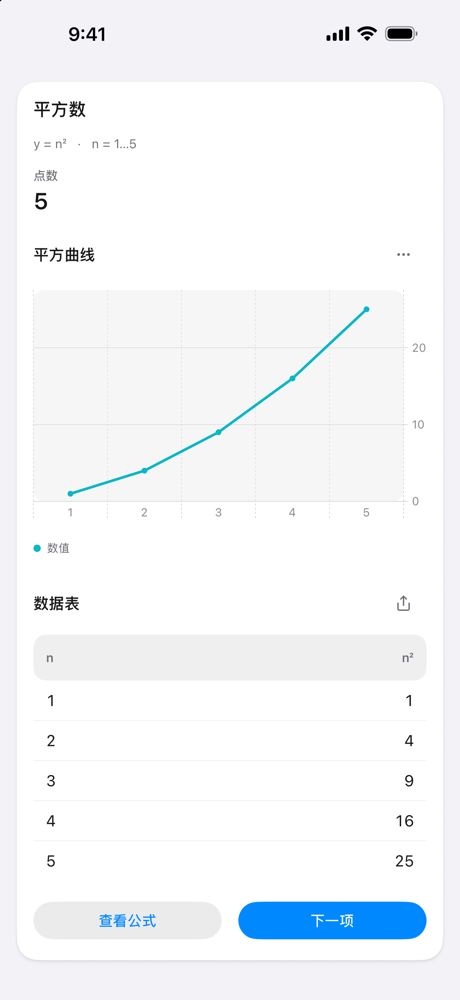

# iOSAgentRenderer

Render interactive agent responses as native SwiftUI cards on iOS 17+ and macOS 14+. The agent sends JSON and the app handles actions. Built with Swift 6, SwiftUI, Charts and MapKit.

把 Agent 返回的 JSON 直接显示成原生卡片。内置表单、图表、可筛选的表格和地图。卡片自己管理输入和选择，点击按钮时由 App 处理回调。



## 直接交给 Agent

把下面这句话发给能操作项目的编程 Agent，就可以从一张卡片开始。

> 请用 Swift Package Manager 把 https://github.com/bug-origin/iOSAgentRenderer 接到当前 iOS App。按仓库里的 ios-agent-renderer Skill 做一张能填写和清空备注的卡片，运行项目验证。

在使用 Agent Skills 的开发工具中，也可以在自己的项目目录运行这条命令，选择要安装到的客户端。以后可以直接说「用 ios-agent-renderer 展示前五个平方数」。[Skill 文件](skills/ios-agent-renderer/SKILL.md) · [Skills CLI](https://skills.sh/docs/cli)

```sh
npx skills add bug-origin/iOSAgentRenderer --skill ios-agent-renderer
```

如果只想让聊天模型输出卡片，把提示词全文发给它，再附上想展示的数据。第一次可以试「做一张平方数卡，显示 1 到 5 的平方，用表格和折线图呈现」。也可以把同一段放进后端模型的系统提示词，每次传入真实的 `context` 和可用的宿主动作。[复制生成卡片的提示词](https://raw.githubusercontent.com/bug-origin/iOSAgentRenderer/0.2.0/skills/ios-agent-renderer/references/card-prompt.md)

### 哪些约定是通用的？

| 部分 | 采用的约定 |
| --- | --- |
| App 安装 Swift 库 | Xcode 内置的 Swift Package Manager，按仓库 URL 和版本添加依赖。[Apple 说明](https://developer.apple.com/documentation/xcode/adding-package-dependencies-to-your-app) |
| Agent 加载 Skill | 开放的 Agent Skills 格式，入口是带 `name` 和 `description` 的 `SKILL.md`。安装入口由客户端提供。[Agent Skills 规范](https://agentskills.io/specification) |
| 描述 JSON 结构 | Schema 使用 JSON Schema Draft 2020-12。[JSON Schema 规范](https://json-schema.org/draft/2020-12) |
| 卡片怎么显示、点击后做什么 | `agent-ui/0.2` 是本库公开定义的协议。组件、状态绑定和动作按这个版本解释，其他渲染器需要实现相同的约定。JSON Schema 校验结构，`renderer-validate` 还会检查组件属性和绑定。[卡片契约](Schema/document.schema.json) · [动作结构](Schema/action.schema.json) |

## 安装

在 Xcode 的 **File → Add Package Dependencies** 中添加 `https://github.com/bug-origin/iOSAgentRenderer.git`，选择 `0.2.0`，把 `AgentRenderer` 和 `AgentRendererCore` 加入展示卡片的 App target。使用 `Package.swift` 时，在包的 `dependencies` 中添加仓库依赖。

```swift
.package(url: "https://github.com/bug-origin/iOSAgentRenderer.git", from: "0.2.0")
```

在展示卡片的 target 的 `dependencies` 中加入这两个产品。

```swift
.product(name: "AgentRenderer", package: "iOSAgentRenderer"),
.product(name: "AgentRendererCore", package: "iOSAgentRenderer")
```

## 在对话里显示一张卡片

收到 JSON 后为这条消息创建一次会话。用 `RendererView` 显示它，把 `onAction` 接到 App 的动作处理函数，返回实际执行结果。

```swift
import AgentRenderer
import AgentRendererCore
import Foundation
import SwiftUI

@MainActor
func makeCardSession(
    from data: Data,
    onAction: @escaping @MainActor (ActionEnvelope) async throws -> ActionOutcome
) throws -> RendererSession {
    let document = try RenderDocument.decode(data)
    return try RendererSession(document: document, onAction: onAction)
}

struct AgentCard: View {
    let session: RendererSession

    var body: some View {
        RendererView(session: session)
    }
}
```

消息离开屏幕后保留会话，返回时就能继续填写。同一卡片收到新修订时，调用 `session.replace(spec:state:context:)`。

## 给 Agent 的输入格式

一张卡片包含 `protocolVersion`、`context`、`spec` 和 `state`。使用 `agent-ui/0.2` 作为版本，`spec.root` 指向 `spec.elements` 中的根组件，`state` 分为 `data`、`form` 和 `ui`。组件目录列出每种组件接受的属性、插槽和事件。可以先用备注表单跑通事件回调，再让 Agent 生成同样格式的文档。[可运行的备注表单](Examples/note.json) · [文档结构](Schema/document.schema.json) · [组件目录](Sources/AgentRendererCore/Resources/catalog.json)

## 运行示例

```sh
swift test
swift run renderer-validate < Examples/note.json
```

要在 App 中浏览全部示例，将 `AgentRendererExamples` 加入 target，显示 `RendererGallery()`。图库会在本地显示动作结果。macOS 上也可以用 `swift run renderer-snapshots /tmp/agent-cards sequence-card` 导出预览图。

## 设计和许可

默认主题参考 HeroUI Native，部分组件的交互参考 HeroUI Agents 的公开设计。图标使用 Lucide。库以 Apache-2.0 发布。[许可证](LICENSE) · [第三方署名](THIRD_PARTY_NOTICES.md)
